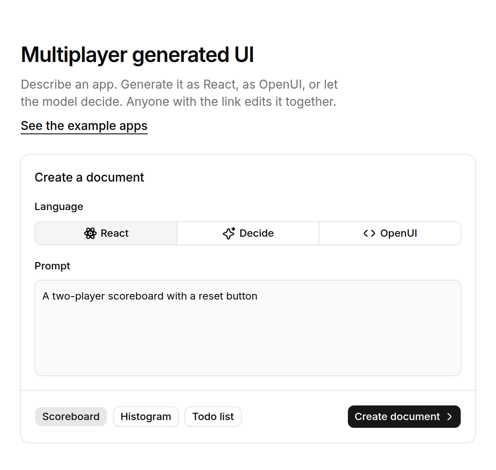
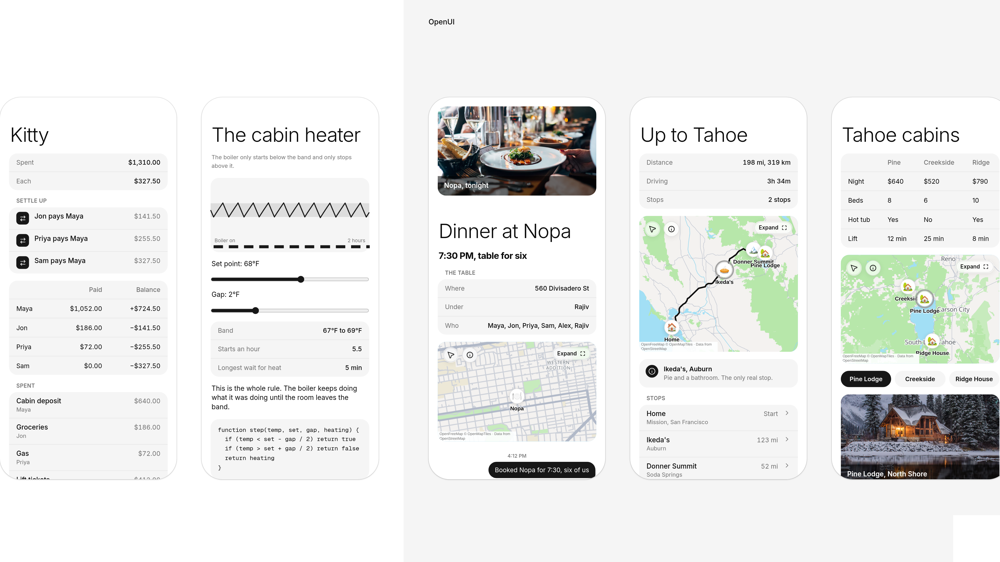
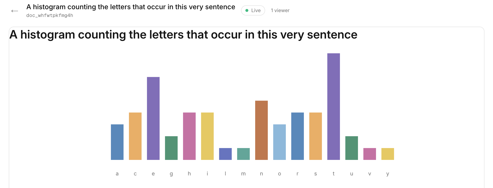

# Multiplayer

Describe an app. Generate it as React, as OpenUI, or let the model decide, then anyone with the link edits it together.

## Landing



The landing page is a prompt. React and OpenUI are explicit, and Decide lets the agent choose. Create document runs that agent. It submits a title, a schema, and source. The shell compiles the source and opens the document.

## Showcase



The showcase is a row of example apps in phone frames. React is on the left, OpenUI on the right. These are the same kinds of views the landing prompt generates, already compiled and laid out side by side.

## A generated view



This one was asked to count the letters in its own sentence. The chart is the generated view, inside an iframe under the document header. Live means the shell is connected. This view stores nothing: its schema has no keys, and the bars are computed from the sentence.

## How a document behaves

React source is one component. It may import React, `sync`, and `ui`. `ui` is the canvas kit the view is styled with: layout, type, inputs, charts, and a todo list. OpenUI source is a Cupertino program and does not share state. The shell bundles either one and publishes it as the document's view. Both open in a phone frame beside the source.

The schema is the shared state. Each key is one of:

- **text.** A string. Typing merges. Two people can edit the same field, and an edit inside a run of repeated characters is placed at the caret.
- **register.** A boolean, string, or number. The later write wins.
- **list.** An ordered collection of items. Two inserts at the same spot both stay. Deleting one item leaves the other. An update merges fields: different fields both remain, and the same field keeps the later value. A text field on an item is edited as `listId/itemId/field`, so typing there merges too.

The view posts edits to the shell. The shell holds the connection and pushes the current value of each subscribed key back into the iframe. Each client keeps one batch in flight. Local edits show immediately and stay on screen until the server acknowledges them. The server sequences every batch. Text operations are transformed against anything that landed after the client's base version. Registers and list items are applied in that order. A reconnect sends a snapshot, or the missed batches when the client is close enough to catch up.

Focusing a control outlines it for the other viewers.

## Running it

Next serves the shell. Bun serves documents, the websocket, and the view iframe, and stores them in SQLite.

```
pnpm dev
pnpm api
```

`OPENAI_API_KEY` is read from the environment or `.env`. The shell listens on port 3002. The dataplane listens on port 3003.
